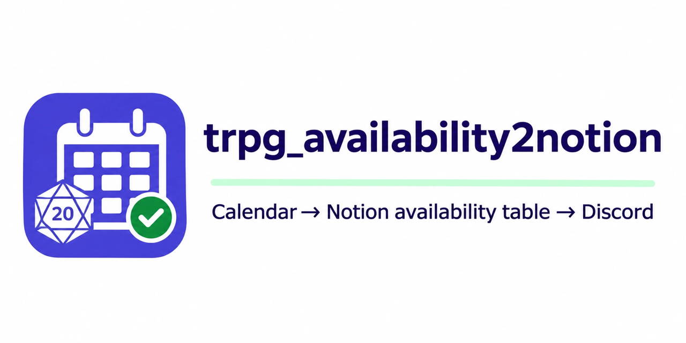
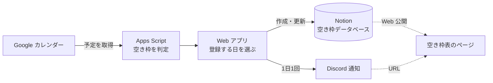

# 空き枠をNotionに追加するツール

Google カレンダーの予定から TRPG セッションの空き枠（朝・昼・夜）を判定し、Notion の空き枠表に登録する Google Apps Script です。
登録すると Discord に「◯月まで最新化しました」と通知します。

PL さんに空き日程を聞かれるたびにカレンダーを見返す代わりに、Notion で Web 公開した空き枠表を見てもらう、という使い方を想定しています。

## 仕組み

1. **空き枠の判定**：Web アプリを開くと、取得期間の各日について、朝・昼・夜が空いているかを自分のカレンダーの予定から判定します。
   取得期間は初期値が「翌日〜翌月末」で、画面で開始日・終了日を変えて「再判定」を押すと変更できます（最大180日）。
2. **確認して登録**：判定結果が表で表示されるので、登録したい日にチェックを付けてボタンを押します。
   同じ日付のページが Notion にあれば上書きし、なければ作成します。
3. **Discord に通知**：登録が終わると、Discord に「◯月まで最新化しました」と空き枠表の URL を投稿します。
   通知するかどうかは登録のたびに画面のチェックボックスで選べます。同じ日に何度登録し直しても、通知は1日1回だけです。

自動で毎日更新するのではなく、**判定結果を自分の目で確認してから登録する**作りにしています。カレンダーに入れていない予定がある日は、チェックを外して登録しないようにできます。

## 判定のルール

| 時間帯 | 判定する時刻 |
| --- | --- |
| 朝 | 9:00〜12:00 |
| 昼 | 13:00〜19:00 |
| 夜 | 21:00〜24:00 |

- 時間指定の予定が少しでも重なっている時間帯は NG
- 終日予定がある日は、朝・昼・夜すべて NG（複数日にまたがる予定はその全日）
- 朝・昼・夜すべて NG の日は一覧に出さない
- 判定に使うのは、自分が所有しているカレンダーだけ（祝日カレンダーなど購読しているものは対象外）
- 任意：除外したカレンダー（`EXCLUDE_CALENDARS`）の予定は無視する
- 任意：特定の予定の **前日の夜** を NG にする（`EVE_NG_CALENDAR_NAME` と `EVE_NG_KEYWORD`）
  - 例：仕事のカレンダーに「リリース」という予定がある日の前夜は、セッションを入れない

時刻を変える場合は `src/Code.js` の `SLOTS` を編集してください。

## Notion データベースの形式

| プロパティ名 | 種類 | 内容 |
| --- | --- | --- |
| 名前 | タイトル | 「セッション可能」が入る |
| 日付 | 日付 | |
| 朝 | セレクト | `OK` / `NG` |
| 昼 | セレクト | `OK` / `NG` |
| 夜 | セレクト | `OK` / `NG` |
| 備考 | テキスト | 作成時は空。手で書き込む用 |

プロパティ名を変える場合は `src/Code.js` の `NOTION_PROPERTY` を編集してください。
更新時に書き換えるのは朝・昼・夜だけなので、備考に書いたメモは残ります。

PL さんに見せるときは、Notion の「共有」>「公開」でデータベースのページを Web 公開し、その URL を `NOTION_PUBLIC_URL` に設定します。

## セットアップ

1. Apps Script プロジェクトを作り、`src/` の3ファイル（`Code.js`、`index.html`、`appsscript.json`）を配置する
   （[clasp](https://github.com/google/clasp) を使う場合は `.clasp.json` の `rootDir` を `src` にして `clasp push`）
2. Notion で上の形式のデータベースを作る
3. Notion で[インテグレーション](https://www.notion.so/my-integrations)を作成し、データベースに接続（コネクト）する
4. 「プロジェクトの設定」>「スクリプト プロパティ」に以下を登録する

   | キー | 必須 | 内容 |
   | --- | --- | --- |
   | `NOTION_TOKEN` | ○ | Notion インテグレーションのシークレット |
   | `NOTION_DATABASE_ID` | ○ | データベース ID |
   | `DISCORD_WEBHOOK_URL` | | 通知先チャンネルの Webhook URL（未設定なら通知しない） |
   | `NOTION_PUBLIC_URL` | | 通知に載せる空き枠表の URL |
   | `EXCLUDE_CALENDARS` | | 判定から除外するカレンダー名（カンマ区切り。例：`routine work,healthcare`） |
   | `EVE_NG_CALENDAR_NAME` | | 前日の夜を NG にする予定を探すカレンダー名 |
   | `EVE_NG_KEYWORD` | | その予定のタイトルに含まれる文字列 |

5. エディタで `checkConfig` を実行し、ログで設定を確認する（読み取りのみで、何も書き込みません）
   - `notion: "HTTP 200"` と `notionProperties: "OK"` になれば Notion の設定は完了
   - `calendars` に判定対象のカレンダー名が並ぶので、除外したいものがあれば `EXCLUDE_CALENDARS` に追加
6. 「デプロイ」>「新しいデプロイ」で **ウェブアプリ** としてデプロイする
   - 次のユーザーとして実行：**自分**
   - アクセスできるユーザー：**自分のみ**（自分のカレンダーを読み、Notion に書き込むため）
7. 発行された URL を開くと空き枠の一覧が出るので、登録したい日を選んで「選択した空き枠をNotionに追加」を押す

## 画面でできること

| 項目 | 内容 |
| --- | --- |
| 取得期間 | 判定する期間。初期値は翌日〜翌月末で、変えたら「再判定」を押す（最大180日） |
| 朝だけOKの日を外す | 昼・夜が NG で朝だけ空いている日のチェックをまとめて外す（外したあとも個別にチェックし直せる） |
| Notionの既存データをすべて削除してから登録する | 下の説明を参照 |
| Discordに通知する | 登録後に Discord へ通知するか。`DISCORD_WEBHOOK_URL` が未設定のときは選べない |
| 各日のチェック | 登録する日を選ぶ。見出しのチェックで全選択・全解除 |
| OK / NG | 押すと OK と NG が切り替わり、その内容で登録される。判定結果から変えたものは点線と「*」で示す |

「Notionの既存データをすべて削除してから登録する」にチェックを入れると、データベースのページをすべてアーカイブしてから登録し直します（過去の日付を一掃したいとき用）。

## 関数

| 関数 | 用途 |
| --- | --- |
| `doGet` | Web アプリの画面を表示する |
| `getAvailableDays` | 指定期間の空き枠を判定する（画面の「再判定」から呼ばれる） |
| `addSelectedToNotion` | 選んだ空き枠を Notion に登録する（画面から呼ばれる） |
| `checkConfig` | 設定・接続を確認する（読み取りのみ） |
| `testDiscordNotification` | Discord に通知を1回送ってみる |
| `resetDiscordNotification` | 「今日は通知済み」の記録を消す |

## 速さについて

- カレンダーの予定は、カレンダーごとに1回だけまとめて取得し、判定はメモリ上で行います。
- Notion への登録は、対象期間の既存ページを1回の検索でまとめて取得し、作成・更新を3件ずつ並列で送ります。
  Notion API のレート制限（429）に当たった場合は、待ってから送り直します。

## ライセンス

[MIT License](LICENSE)
